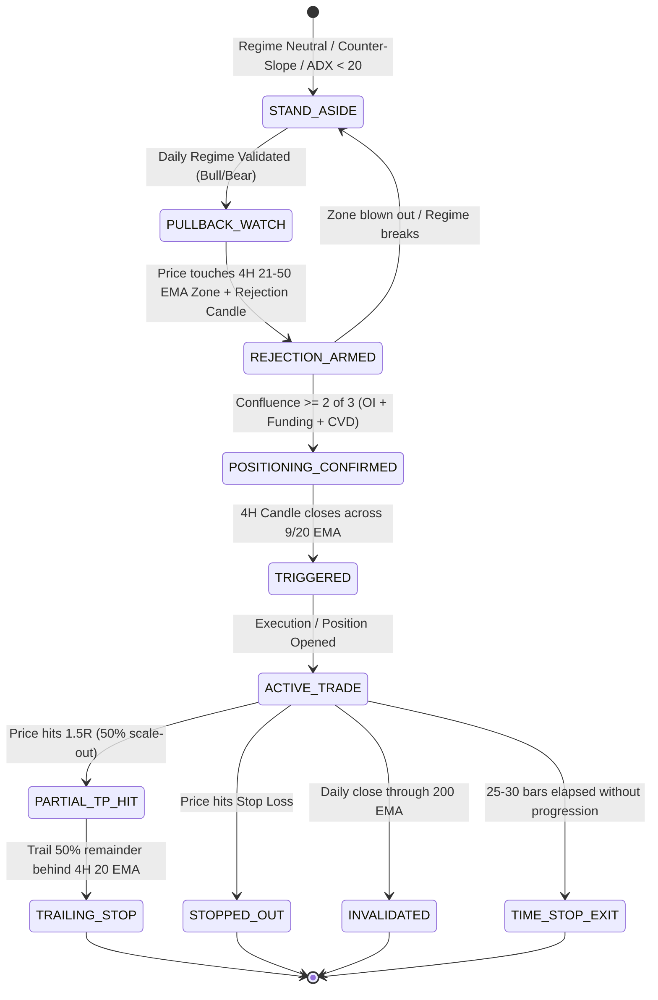

# Technical Specification: Industrial 3 EMA Strategy for BTC (Bidirectional)
**Component Module for BTC Swing Engine v1**  
**Document ID:** `SPEC-STRAT-3EMA-V1`  
**Target Target Session:** `3.3 BTC Swing Screener Technical Discussion | b724e489-311f-48ff-ac10-aae884c7d07b`

---

## 1. Executive Summary & Strategy Identity

### 1.1 What is the Industrial 3 EMA Strategy?
In naive retail trading, a "3 EMA Strategy" is typically treated as a mechanical moving-average crossover system (e.g., fast EMA crossing medium and slow EMAs). In cryptocurrency markets, naive EMA crossover systems fail catastrophically: they suffer severe whipsaws during chop, lag at market cycle peaks, and repeatedly buy false tops or short false bottoms.

The **Industrial 3 EMA Strategy for BTC** is a production-grade, rules-based trend-following and value-retest swing trading system. It decouples **Macro Regime Identification** from **Execution Geometry** and gates all trades behind **Order Flow / Positioning Confluence**.

### 1.2 Core Architectural Principles
1. **Regime Decoupling**: The **Daily** chart defines the permission regime and macro bias; the **4H** chart defines pullbacks, rejection evidence, triggers, and active risk management.
2. **Pullback Only (Anti-Chasing)**: Trades are strictly forbidden when price is extended. Entries occur exclusively when price retraces into the **Dynamic Value Zone** (the 4H 21–50 EMA band or Daily 50 EMA).
3. **Non-Negotiable Macro Anchor**: No trade is ever allowed against the Daily 200 EMA slope and price location.
4. **Order Flow & Positioning Gating**: Moving averages show where price has been; market positioning (Open Interest, Funding Rate, Spot vs. Perp CVD) reveals whether market participants are trapped or absorbing. At least 2 of 3 positioning confirmations are mandatory before risk is deployed.
5. **Asymmetric Directional Bias**: Longs receive full size ($0.75\%$ equity risk); shorts are strictly conservative ($0.40\text{--}0.50\%$ equity risk) and require stricter confirmation to account for Bitcoin's structural macro upside skew.

---

## 2. Parameter Set & Timeframe Hierarchy

| Parameter | Value | Role |
| :--- | :--- | :--- |
| **Daily EMAs** | 20, 50, 200 | Macro regime, trend alignment, non-negotiable bias anchor |
| **4H EMAs** | 20, 50, 200 | Value zone boundary, trailing stop reference |
| **4H Trigger EMA** | 9 EMA | Precise momentum trigger candle close |
| **Trend Quality** | ADX (14) | Volatility/expansion filter (minimum $\ge 20$) |
| **Volatility Metric** | ATR (14) | Stop-loss distance, value zone tolerances, chop bounds |
| **Primary Pair** | BTCUSDT (Perpetual / Spot overlay) | Primary execution instrument |

---

## 3. Detailed Strategy Rules

### Module 1: Daily 200 EMA Regime & Bias Filter (Highest Priority)
All calculations run on **closed Daily candles**.

$$\text{Slope}_{\text{Daily200}} = \left(\frac{\text{EMA}_{200}[i] - \text{EMA}_{200}[i-5]}{|\text{EMA}_{200}[i-5]|}\right) \times 100$$

* **Flat / Chop Threshold**: $|\text{Slope}_{\text{Daily200}}| \le 0.05\%$
* **Chop Proximity**: $|P - \text{EMA}_{200}| \le 0.3 \times \text{ATR}_{\text{Daily}}$

| Condition | Bias Classification | Permitted Engine Actions | Risk Multiplier |
| :--- | :--- | :--- | :--- |
| Price > rising 200 EMA **and** $\text{EMA}_{20} > \text{EMA}_{50} > \text{EMA}_{200}$ | **Strong Bull** | Longs Only | $1.0\times$ ($0.75\%$ risk) |
| Price > 200 EMA, slope flat/rising, but EMAs tangled | **Weak Bull** | Longs Only (Size down) | $0.6\times$ ($0.45\%$ risk) |
| Price < falling 200 EMA **and** $\text{EMA}_{20} < \text{EMA}_{50} < \text{EMA}_{200}$ | **Strong Bear** | Shorts Allowed | $1.0\times$ ($0.50\%$ risk) |
| Price < 200 EMA, slope falling, but EMAs tangled | **Weak Bear** | Cash preferred; Shorts need 3/3 confluence | $0.5\times$ ($0.25\%$ risk) |
| 200 EMA flat, or price chopping within 0.3 ATR of 200 EMA | **Neutral** | **STAND ASIDE / 100% Cash** | $0.0\times$ (No trades) |
| Price > falling 200 EMA OR Price < rising 200 EMA | **Counter-Slope** | **STAND ASIDE / 100% Cash** | $0.0\times$ (No trades) |

> **NON-NEGOTIABLE RULE**: Trading against the Daily 200 EMA slope and price location is strictly rejected by the engine state machine.

---

### Module 2: Trend Quality Filter
* **Condition**: $\max(\text{ADX}_{\text{Daily}}[14], \text{ADX}_{4\text{H}}[14]) \ge 20$.
* If $\text{ADX} < 20$ and EMAs are flat or tangled $\rightarrow$ Transition engine state to `STAND_ASIDE`. Prevents low-volatility liquidity chop traps.

---

### Module 3: 4H Pullback & Value Zone Geometry
Trades are triggered exclusively on pullbacks into value, never on breakouts.

* **4H Value Zone Definition**:
  $$\text{Zone}_{\text{Low}} = \min(\text{EMA}_{20}, \text{EMA}_{50}) - 0.75 \times \text{ATR}_{4\text{H}}$$
  $$\text{Zone}_{\text{High}} = \max(\text{EMA}_{20}, \text{EMA}_{50}) + 0.75 \times \text{ATR}_{4\text{H}}$$
* **Lookback Window**: Last 12 closed 4H candles ($48\text{ hours}$).
* **Qualification**:
  1. Price must have approached the zone from the trend direction (Longs: prior candle highs were above $\text{Zone}_{\text{High}}$; Shorts: prior candle lows were below $\text{Zone}_{\text{Low}}$).
  2. At least one bar's range in the lookback window must have traded inside $[\text{Zone}_{\text{Low}}, \text{Zone}_{\text{High}}]$.
  3. Price must remain within reasonable proximity ($\le \text{Zone}_{\text{High}} + 1.2 \times \text{ATR}_{4\text{H}}$ on longs) to ensure the setup has not already run away.

---

### Module 4: Candlestick Rejection Evidence
The engine evaluates the **last 3 closed 4H bars** (multi-bar memory) to ensure standard 2-bar pullback-to-trigger sequences fire cleanly.

At least one of the following must be verified within the pullback window:
1. **Pinbar / Long Wick**:
   * Longs: $\text{LowerWick} \ge 0.50 \times \text{Range}$ (Hammer / Absorption wick).
   * Shorts: $\text{UpperWick} \ge 0.50 \times \text{Range}$ (Shooting star / Liquidation wick).
2. **Engulfing Candle**:
   * Bullish engulfing candle on longs; Bearish engulfing candle on shorts.
3. **Strong Rejection Close**:
   * Bullish close back across the 20 EMA or 9 EMA on longs; Bearish close back below on shorts.

---

### Module 5: Positioning & Order Flow Confluence (At least 2 of 3 required)
Evaluated over the pullback window ($t_{\text{start}}$ to $t_{\text{close}}$):

$$\text{CVD Bar Delta: } \Delta_{\text{CVD}} = 2 \times \text{TakerBuyBaseVolume} - \text{TotalVolume}$$

#### 1. Open Interest (OI)
* **Longs**: OI declining or stable ($\Delta_{\text{OI}} \le +0.5\%$). Indicates long liquidation / flush rather than aggressive short absorption.
* **Shorts**: OI rising into the rally ($\Delta_{\text{OI}} > 0\%$). Indicates late retail longs piling in at resistance.

#### 2. Funding Rate (8h)
* **Longs**: Neutral or negative ($\text{FundingRate} \le +0.0100\%$ per 8h). Eliminates overcrowded leveraged long positioning.
* **Shorts**: Elevated positive ($\text{FundingRate} \ge +0.0300\%$ per 8h / $+32.8\%$ annualized). Indicates extreme retail bullish leverage.

#### 3. Spot vs. Perp CVD Divergence
* **Longs**: Spot CVD holding up or diverging positively:
  $$(\Delta_{\text{SpotCVD}} > 0 \text{ and } \Delta P < 0) \quad \text{OR} \quad (\Delta_{\text{SpotCVD}} > \Delta_{\text{PerpCVD}})$$
  Proves spot whales are passively absorbing perp panic-dumping.
* **Shorts**: Perp-led rally failing on spot:
  $$\Delta_{\text{PerpCVD}} > \Delta_{\text{SpotCVD}}$$
  Proves the rally is purely synthetic perpetual leverage without spot backing.

* **Confluence Threshold**: Minimum **2 of 3** conditions required (**3 of 3** required for Weak Bear shorts).

---

### Module 6: Trigger Candle Close
* **Long Trigger**: 4H candle closes back **above** the 9 EMA or 20 EMA after dipping into the zone.
* **Short Trigger**: 4H candle closes back **below** the 9 EMA or 20 EMA after rallying into the zone.
* **Rule**: Evaluated **only on candle close**. Unclosed bars cannot generate a trigger.

---

## 4. Risk, Sizing, Stop & Exit Mathematics

### 4.1 Stop-Loss Placement ("Whichever is Wider")
* **Long Stop**:
  $$\text{Stop}_{\text{Extreme}} = \text{LowestLow}_{\text{Pullback}} - 0.10 \times \text{ATR}_{4\text{H}}$$
  $$\text{Stop}_{\text{ATR}} = \text{EMA}_{50}[4\text{H}] - 1.25 \times \text{ATR}_{4\text{H}}$$
  $$\text{Stop}_{\text{Long}} = \min(\text{Stop}_{\text{Extreme}}, \text{Stop}_{\text{ATR}})$$
  $$\text{Safety Clamp}: \text{Stop}_{\text{Long}} \le P_{\text{Entry}} - 0.50 \times \text{ATR}_{4\text{H}}$$

* **Short Stop**:
  $$\text{Stop}_{\text{Extreme}} = \text{HighestHigh}_{\text{Pullback}} + 0.10 \times \text{ATR}_{4\text{H}}$$
  $$\text{Stop}_{\text{ATR}} = \text{EMA}_{50}[4\text{H}] + 1.25 \times \text{ATR}_{4\text{H}}$$
  $$\text{Stop}_{\text{Short}} = \max(\text{Stop}_{\text{Extreme}}, \text{Stop}_{\text{ATR}})$$
  $$\text{Safety Clamp}: \text{Stop}_{\text{Short}} \ge P_{\text{Entry}} + 0.50 \times \text{ATR}_{4\text{H}}$$

### 4.2 Exact Position Sizing Formula
$$\text{StopDistance} = |P_{\text{Entry}} - \text{Stop}|$$
$$\text{DollarRisk} = \text{AccountEquity} \times \text{RiskPercentage}$$
$$\text{PositionQty}_{\text{BTC}} = \frac{\text{DollarRisk}}{\text{StopDistance}}$$
$$\text{PositionNotional}_{\text{USDT}} = \text{PositionQty}_{\text{BTC}} \times P_{\text{Entry}}$$

### 4.3 Trade Management & Exit Rules
1. **Partial Take-Profit 1 (1.5R)**: Close $50\%$ of position when price reaches:
   $$P_{\text{TP1}} = P_{\text{Entry}} \pm 1.5 \times \text{StopDistance}$$
2. **Partial Take-Profit 2 (2.0R)**: Optional second scale-out:
   $$P_{\text{TP2}} = P_{\text{Entry}} \pm 2.0 \times \text{StopDistance}$$
3. **Trailing Stop**: Trail the remaining $50\%$ behind the **4H 20 EMA** or higher-low structural pivots.
4. **Hard Invalidation**: Immediate complete exit if a **Daily close** breaches the Daily 200 EMA against the trade direction.
5. **Time-Based Exit (Dead Capital Rule)**: If neither TP1 nor trailing stop has been hit after **25–30 bars on 4H** (100–120 hours), close or tightly trail the trade to free margin.

---

## 5. Finite State Machine (FSM) Lifecycle

---

## 6. Implementation Checklist for `BTC Swing Engine v1`

### Data Ingestion Layer (`collectors/`)
- [ ] Ingest **Daily klines** (`1d`) and **4H klines** (`4h`) for BTCUSDT (Perp & Spot).
- [ ] Compute bar-level CVD from taker buy volume: `delta = 2 * taker_buy_base - volume`.
- [ ] Ingest current Open Interest & 1h historical series (`fapi/v1/openInterest`).
- [ ] Ingest live Funding Rate & 8h history (`fapi/v1/premiumIndex`).

### Analytical Engine (`analytics/` / `core/`)
- [ ] Implement zero-lag Wilder's ADX(14) without forward index-offset distortion.
- [ ] Implement Daily 200 EMA slope calculation over a 5-bar closed lookback.
- [ ] Implement 4H 21–50 EMA dynamic value zone with $0.75 \times \text{ATR}$ buffer.
- [ ] Implement multi-bar (3-bar) rejection candle detector (pinbars $\ge 50\%$, engulfing, strong closes).
- [ ] Implement Spot vs. Perp CVD divergence logic (Spot absorption verification).

### Execution & Signals (`fsm/` / `signals/`)
- [ ] Enforce non-negotiable Daily 200 EMA slope blocker in state machine guards.
- [ ] Formulate stop distance using the "whichever is wider" comparison with $0.5 \times \text{ATR}$ clamp.
- [ ] Compute exact contract sizing from user equity ($0.75\%$ long / $0.50\%$ short / scaled weak tiers).
- [ ] Expose state outputs: `STATUS` (`NO_SETUP`, `LONG_WATCH`, `SHORT_WATCH`, `LONG_TRIGGERED`, `SHORT_TRIGGERED`), `VERDICT_BANNER`, and trade parameters.
