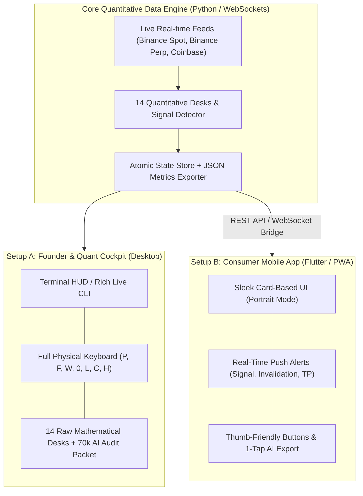

# 🚀 BTC SWING ENGINE: COMPREHENSIVE ARCHITECTURAL DOSSIER & MOBILE TRANSITION BRIEF

> **Document Purpose**: This dossier provides a complete technical, quantitative, and architectural breakdown of the **BTC Swing Engine**. It is formatted as a master prompt and review document for **Grok (xAI)** to:
> 1. Conduct an independent quantitative and risk management audit.
> 2. Architect the native **Mobile Version (Setup B)**, detailing exactly what components to retain, adapt, or exclude for a consumer-grade mobile user experience.

---

```
╔══════════════════════════════════════════════════════════════════════════════════════════════╗
║                          PROMPT FOR GROK (COPY & PASTE READY)                                ║
╚══════════════════════════════════════════════════════════════════════════════════════════════╝
```

### PROMPT TO GROK:

> "Hi Grok. I am sharing the complete architectural specification and quantitative blueprint of our institutional **BTC Swing Engine**. 
> 
> We have built and verified a 14-desk quantitative engine with 162 automated unit tests running on live market feeds. We are now preparing to transition this system into a sleek, consumer-ready **Mobile App (iOS/Android via Flutter or PWA)**.
> 
> Please review this document in detail and provide:
> 1. **Quantitative & Risk Audit**: Critique our 4-pillar confluence model, edge viability, and spot-only 0.75% risk framework.
> 2. **Mobile Architecture Blueprint**: Design the mobile application layout, information hierarchy, and data pipeline.
> 3. **Element Filtering**: Adhere strictly to the **Included Elements** and **Excluded Elements** specified in Section 5 below.
> 4. **User Experience Strategy**: Explain how a beginner or retail swing trader can use this app to trade with institutional discipline without cognitive overload."

---

## 1. EXECUTIVE SUMMARY & INTENT

### 1.1 The Core Mission
The **BTC Swing Engine** is an institutional-grade algorithmic screening, surveillance, and trade-generation platform designed specifically for **Bitcoin (BTC)**. 

Most retail traders fail in crypto due to three fatal pitfalls:
1. **Excessive Leverage & Liquidation Risk**: Getting wicked out during derivative cascades.
2. **Sycophancy & Overtrading**: Chasing green candles at local tops (FOMO) or panicking at local bottoms without multi-timeframe structural confluence.
3. **Cognitive Overload**: Staring at 20 disconnected charts, indicators, and Twitter feeds without a unified mathematical model.

The BTC Swing Engine solves this by replacing emotional discretion with a **deterministic, 4-Pillar Confluence Scorecard** and an unyielding **Capital Preservation Mandate**.

### 1.2 Non-Negotiable Operational Rules & Constraints
* **Spot BTC Only**: Zero leverage. Zero futures margining. Zero shorting. The engine never borrows against capital and eliminates 100% of exchange liquidation risk.
* **Capital Risk Cap**: Strictly **0.75% maximum equity risk per trade** ($750 maximum loss on a standard $100,000 reference account). Position size is dynamically derived from distance to the mathematical invalidation level ($Position = \frac{\$750}{Entry - Invalidation}$).
* **Multi-Day Holding Horizon**: Built for swing trading across multi-day to multi-week cycles (not high-frequency scalping).
* **Asymmetric Risk-Reward**: Minimum acceptable trade setup ratio is **1:2.5 R:R**, typically targeting 1:3 to 1:5 into macro liquidity pools.
* **Deterministic Invalidation**: No trade is ever initiated without a prior structural invalidation price (e.g., HTF Swing Low, daily Order Block base, or liquidity sweep origin). If the invalidation level is breached, the thesis is dead.

---

## 2. THE BICAMERAL ROADMAP: SETUP A VS. SETUP B

The project follows a deliberate **Bicameral Product Architecture**:



* **Setup A (Founder & Quant Cockpit - Active Today)**:
  A high-density, real-time terminal user interface (Terminal HUD) running locally on the desktop/server. Built for quantitative deep-dives, strategy auditing, monitoring microsecond order book footprints, and exporting 70,000+ character raw AI telemetry packets.
* **Setup B (Consumer Mobile App - Target Phase)**:
  A sleek, thumb-friendly mobile application built for mobile traders, retail investors, and beginners. It translates the dense mathematical engine into intuitive visual cards, risk calculators, progress meters, and real-time push alerts.

---

## 3. THE 4-PILLAR CONFLUENCE ENGINE (MATHEMATICAL MODEL)

The engine evaluates market state at 2 Hz across four independent quantitative pillars. A trade setup requires multi-pillar confluence (Score $\ge 70/100$) before generating an active execution alert.

```
┌────────────────────────────────────────────────────────────────────────────────────────┐
│                               4-PILLAR CONFLUENCE MATRIX                               │
├──────────────────────────┬──────────────────────────┬──────────────────────────────────┤
│ PILLAR                   │ KEY METRICS & DETECTORS  │ QUANTITATIVE PURPOSE             │
├──────────────────────────┼──────────────────────────┼──────────────────────────────────┤
│ 1. Market Structure &    │ • Daily & 4h SLSP        │ Confirms institutional trend     │
│    Order Flow            │ • MSS / BOS Confirmation │ direction, swing high/low ranges,│
│                          │ • 15m Footprint Delta    │ and passive limit absorption     │
│                          │ • Point of Control (POC) │ at key structural levels.        │
├──────────────────────────┼──────────────────────────┼──────────────────────────────────┤
│ 2. Derivatives &         │ • Liquidation Cascades   │ Identifies trapped retail leverage│
│    Liquidity Dynamics    │ • Waterfall Absorption   │ forced liquidations, and spot vs.│
│                          │ • Coinbase Premium (CPI) │ perp divergences (smart money vs.│
│                          │ • CVD Divergences        │ retail perp chasing).            │
├──────────────────────────┼──────────────────────────┼──────────────────────────────────┤
│ 3. Macro & Intermarket   │ • DXY (Dollar Index)     │ Measures global liquidity tide,  │
│    Radar                 │ • US 10Y Treasury Yields │ institutional ETF inflows, and   │
│                          │ • NDX / SPX Correlation  │ risk-on vs. risk-off capital     │
│                          │ • Stablecoin Supply/Mints│ allocation cycles.               │
├──────────────────────────┼──────────────────────────┼──────────────────────────────────┤
│ 4. Volatility &          │ • 72h Volatility Cone    │ Flags statistical mean-reversion,│
│    Mathematical          │ • Gartley 222 Harmonics  │ liquidity sweep traps (SFP), and │
│    Exhaustion            │ • Swing Failure Pattern  │ momentum exhaustion tops/bottoms.│
│                          │ • TD Sequential (TD9/13) │                                  │
└──────────────────────────┴──────────────────────────┴──────────────────────────────────┘
```

---

## 4. THE LIVE COCKPIT: THE "CLEAN 5" DESKS & SUB-SYSTEMS

The engine consolidates its 14 internal mathematical modules into the **"Clean 5" Operational Cockpit**:

### Desk [P]: Structure Desk (HTF Market Structure & SLSP)
* **Timeframes**: Daily and 4-Hour charts.
* **Core Function**: Maps Structural Liquidity & Swing Points (SLSP). Tracks Market Structure Shifts (MSS), Break of Structure (BOS), and Fair Value Gaps (FVG).
* **Output**: Identifies structural invalidation prices and establishes whether the macro trend is Bullish Expansion, Range Bound, or Bearish Distribution.

### Desk [F]: Footprint Desk (Order Flow & Microstructure)
* **Timeframes**: 15-Minute cluster intervals.
* **Core Function**: Real-time Bid-Ask Volume Delta ladder, Point of Control (POC) migration, and stacked buying/selling imbalances.
* **Output**: Confirms whether price rejections are supported by aggressive aggressive market buyers absorbing passive sellers at support.

### Desk [W]: Waterfall Desk (Liquidation Cascade & Absorption)
* **Timeframes**: 1-Hour rolling window.
* **Core Function**: Detects cascade events where long or short leveraged positions are liquidated in rapid succession. Evaluates post-cascade absorption.
* **Output**: Prevents "catching falling knives" by verifying that selling volume has fully dried up and passive buyers have absorbed the liquidation dump before entry.

### Desk [0]: Spot Swing Screener (Execution & Sizing)
* **Core Function**: The primary execution desk. Generates concrete trade plans when confluence conditions are met.
* **Output**:
  - `ACTION`: `BUY SPOT`, `HOLD SPOT`, `PARTIAL TAKE PROFIT (50%)`, `EXIT CASH`, or `WAITING`.
  - `ENTRY ZONE`: Precise dollar price range.
  - `INVALIDATION`: Strict stop price.
  - `TARGET 1 (TP1)`: First structural liquidity pool (50% de-risk, move stop to break-even).
  - `TARGET 2 (TP2)`: Macro expansion target.
  - `POSITION SIZING`: Exact BTC and USD allocation capped at $750 max risk.

### Desk [L]: Master Synthesis Matrix
* **Core Function**: Aggregates all 14 quantitative desks into a single weighted score (0–100) and market regime classification (e.g., `BULL_MOMENTUM`, `ACCUMULATION_COMPRESSION`, `DISTRIBUTION_EXHAUSTION`, `CHOP_ILLIQUID`).

### On-Demand Sub-Systems:
* **Desk [H]: Beginner Field Manual & Educational Guide**: Built-in, on-demand plain-English manual explaining the active desk's metrics, the 4 Golden Laws of Swing Trading, and actionable rules for capital preservation.
* **Action [C]: 70,000-Character AI Data Packet Exporter**: Compiles a comprehensive Markdown telemetry snapshot containing 100% of order flow, CVD, volume profile, liquidation, and macro variables for independent LLM audit.

---

## 5. SPECIFICATION FOR THE MOBILE APP VERSION (SETUP B)

When architecting the mobile experience, Grok must adhere to the following **inclusion and exclusion guidelines**:

```
┌────────────────────────────────────────────────────────────────────────────────────────┐
│                              MOBILE DESIGN FILTER CRITERIA                             │
├───────────────────────────────────────────┬────────────────────────────────────────────┤
│ 🟢 MUST INCLUDE (CONSUMER-FRIENDLY)        │ 🔴 MUST EXCLUDE (ELIMINATE CLUTTER)         │
├───────────────────────────────────────────┼────────────────────────────────────────────┤
│ • Executive Signal Hero Card (Long/Cash)  │ • Dense ASCII 15m Footprint bid-ask ladders│
│ • Confluence Score Gauge (0-100 meter)    │ • Raw terminal command prompts / SSH shells│
│ • Trade Execution Card: Entry, Inval, TP1 │ • Monospace terminal text-wrapping boxes   │
│ • 0.75% Risk Calculator ($750 cap preview)│ • Complex 14-tab hotkey navigation loops   │
│ • 4-Pillar Visual Health Status Bars      │ • Raw debug logs, stack traces, socket hex │
│ • 1-Tap "Copy AI Dossier to Clipboard"    │ • Leverage, margin, or shorting controls   │
│ • Plain-English "What Does This Mean?"    │ • Multiple overlapping secondary charts    │
│   collapsible tooltips on every metric    │                                            │
│ • Real-time Push Notifications for Alerts │ • Unactionable sub-second tick noise       │
└───────────────────────────────────────────┴────────────────────────────────────────────┘
```

### 5.1 Mobile Screen Layout Concept (Portrait Mode)
1. **Header**: Live BTC/USD Spot Price, 24h Delta, and Market Regime Badge (`ACCUMULATION`, `EXPANSION`, `CAUTION`).
2. **Hero Card: Confluence & Status**:
   - Circular score gauge: e.g., `82/100 (HIGH CONFLUENCE)`.
   - Signal state: `ACTIVE LONG` or `HOLD CASH (WAITING FOR SETUP)`.
3. **Active Trade Plan Card (Only visible when setup exists)**:
   - Entry Range: e.g., `$67,200 - $67,500`
   - Invalidation (Stop): e.g., `$66,100` (-1.8%)
   - Take Profit 1: e.g., `$70,400` (+4.5%, Risk-Reward 1:2.5)
   - Take Profit 2: e.g., `$73,800` (+9.5%, Risk-Reward 1:5.2)
   - Max Capital Risk: `$750.00`
   - Suggested Position: `0.68 BTC ($45,700)`
4. **4-Pillar Confluence Breakdown (Interactive Accordion Cards)**:
   - `Pillar 1: Structure` (🟢 Bullish 4h MSS confirmed at $66.8k)
   - `Pillar 2: Order Flow` (🟢 +1,240 BTC Spot CVD absorption on Coinbase)
   - `Pillar 3: Liquidation` (🟢 $85M short cascade wiped; waterfall settled)
   - `Pillar 4: Macro` (🟡 Neutral DXY compression; ETF inflows positive)
5. **Beginner Guidance Pill (Tap to Expand)**:
   - "Why are we entering here?"
   - "Where is our invalidation and why?"
   - "The 4 Golden Laws of Capital Preservation"
6. **Bottom Action Bar**:
   - `[ 📋 Copy AI Audit Packet ]` (Copies formatted summary directly to phone clipboard for Grok / Claude analysis).
   - `[ 🔔 Notification Settings ]` (Push notifications for signal generation, TP1 hits, or structural invalidation).

---

## 6. INSTRUCTIONS & DELIVERABLES REQUESTED FROM GROK

Please structure your review and response as follows:

1. **Quantitative & Risk Review**:
   - Evaluate the soundness of relying strictly on Spot BTC with a 0.75% equity risk cap.
   - Critique the 4-pillar weighting: where could the model generate false signals, and how does the Waterfall/Absorption filter safeguard against bear trap cascades?
2. **Mobile Architecture & Tech Stack Recommendation**:
   - Recommend the ideal frontend architecture (e.g., Flutter vs. React Native vs. Lightweight PWA) to consume our Python backend's `btc_metrics_latest.json` and WebSocket stream.
   - Propose the backend bridge architecture (FastAPI / WebSockets / Cloudflare Tunnel / Firebase Cloud Messaging for push alerts).
3. **Screen-by-Screen UI/UX Wireframe Specification**:
   - Provide visual ASCII or component-level wireframes for the 3 main mobile screens:
     * Screen 1: **Cockpit Dashboard** (Hero card, 4-pillar gauges, active trade plan).
     * Screen 2: **Deep Dive Detail** (Structure levels, key liquidation clusters, CVD delta).
     * Screen 3: **Beginner Field Manual & AI Copilot** (Plain-English tooltips, 1-tap clipboard copy, chat prompt builder).
4. **Step-by-Step Implementation Roadmap**:
   - Outline the concrete phases required to build and deploy this mobile app seamlessly.

```
╚══════════════════════════════════════════════════════════════════════════════════════════════╝
```
